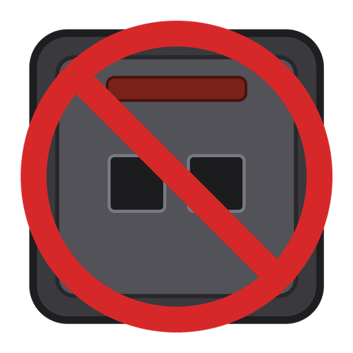
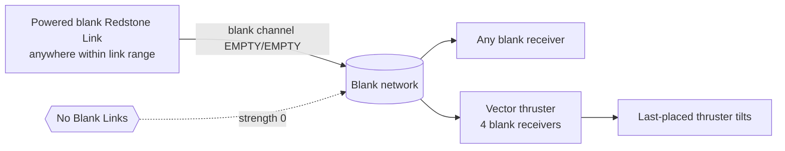

<p align="center">
  
</p>

# Create: No Blank Links

Create Redstone Links with a blank frequency never carry power. A tiny server-side mixin for Create 6 on NeoForge 1.21.1.

[](LICENSE)
[](https://www.minecraft.net/)
[](https://neoforged.net/)
[](https://github.com/Creators-of-Create/Create)
[](https://github.com/SenDeliver/create-no-blank-links/actions/workflows/build.yml)

## What it does

A Redstone Link with **both frequency slots empty** is on the blank channel (`EMPTY/EMPTY`). In vanilla Create that channel is one global network: every powered blank transmitter within link range feeds every blank receiver, on the whole server, whoever placed it.

With this mod the blank channel is dead:

- a blank receiver always reads 0, whatever blank transmitters are around;
- `hasAnyLoadedPower` is `false` for the blank key (Linked Controller display stays consistent);
- links with **at least one** frequency item work exactly as before.

## Why

[Create: Propulsion](https://modrinth.com/mod/create-propulsion) 1.1.5 vector thrusters carry four blank-frequency link receivers and do not refresh their own power after joining the network. One forgotten, powered blank Redstone Link anywhere within link range (256 blocks by default) tilts the last-placed thruster. More generally, a stray blank transmitter leaks into every blank receiver on the server.



## Behaviour change (read this)

**Blank links stop working.** Any build that relies on two Redstone Links with no frequency item will go dark. Put the same item in a slot of both links (an apple, a dirt block, anything) and it works again. Nothing is saved differently; removing the mod brings the old behaviour back.

## Install

1. NeoForge 1.21.1 and Create 6.0.x in `mods/`.
2. Drop `noblanklinks-<version>.jar` into `mods/`.
3. **Server only is enough.** Links are resolved on the server; clients may install it or not (`displayTest = IGNORE_ALL_VERSION`). In singleplayer, install it on the client.

## Compatibility

| Mod | Version |
|---|---|
| Minecraft | 1.21.1 |
| NeoForge | 21.1 or newer (tested 21.1.250) |
| Create | 6.0.7 or newer, below 6.1.0 (tested 6.0.10) |
| Java | 21 |

Only required dependency: Create. One mixin on `RedstoneLinkNetworkHandler`; no blocks, items, config, network packets or save-format changes.

## How it works

- `updateNetworkOf`: the `getTransmittedStrength()` result is replaced by 0 when the actor's network key is blank, so receivers on that key get 0.
- `hasAnyLoadedPower`: returns `false` for a blank key.

## Tests

Headless dedicated server NeoForge 21.1.250 + Create 6.0.10, superflat, 2026-10-24. Layout: transmitter link on a redstone block, receiver link 5 blocks away with a redstone lamp next to it. One pair blank, one pair with an apple in the first slot of both links.

| Case | Without mod | With mod |
|---|---|---|
| Blank pair (no frequency items) | lamp lit, receiver `Receive: 15` | lamp off, receiver `Receive: 0` |
| Apple pair (apple on both) | lamp lit, `Receive: 15` | lamp lit, `Receive: 15` |

`tools/server.sh start [no-mod|with-mod]` installs and starts a scratch server in `run/server-real`, `python3 tools/rcon.py < tools/scen-links.txt` runs the scenario, `tools/server.sh stop` stops it. Not tested: Linked Controller in hand on the blank channel, links on moving contraptions.

## Downloads

- [GitHub Releases](https://github.com/SenDeliver/create-no-blank-links/releases)
- Modrinth and CurseForge: coming

## Building from source

Needs JDK 21 or newer (Gradle uses a Java 21 toolchain and downloads it if missing). Built with ModDevGradle.

```sh
./gradlew build        # jar in build/libs/
./gradlew runServer    # dev server
./gradlew runClient    # dev client
```

## Contributing

Bug reports and pull requests are welcome. See [CONTRIBUTING.md](CONTRIBUTING.md) and the [Code of Conduct](CODE_OF_CONDUCT.md). Security problems: [SECURITY.md](SECURITY.md).

## License and credits

Create: No Blank Links is released under the [MIT License](LICENSE). Copyright (c) 2026 Denys Selivanov.

Built on top of, but **not bundling**, [Create](https://github.com/Creators-of-Create/Create) by the Create team (MIT). Developed with AI assistance (Claude).
